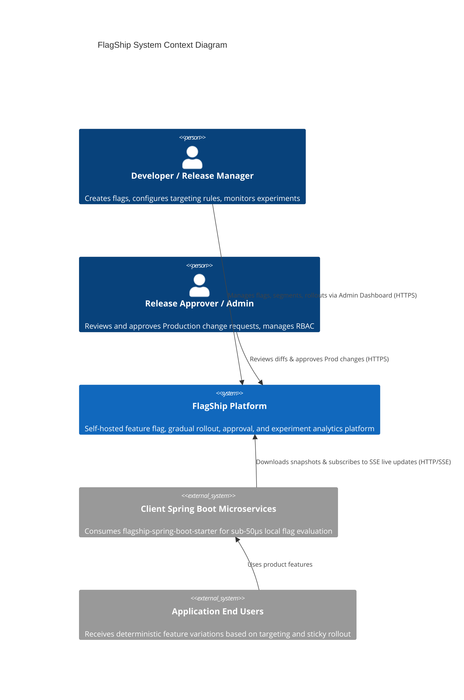
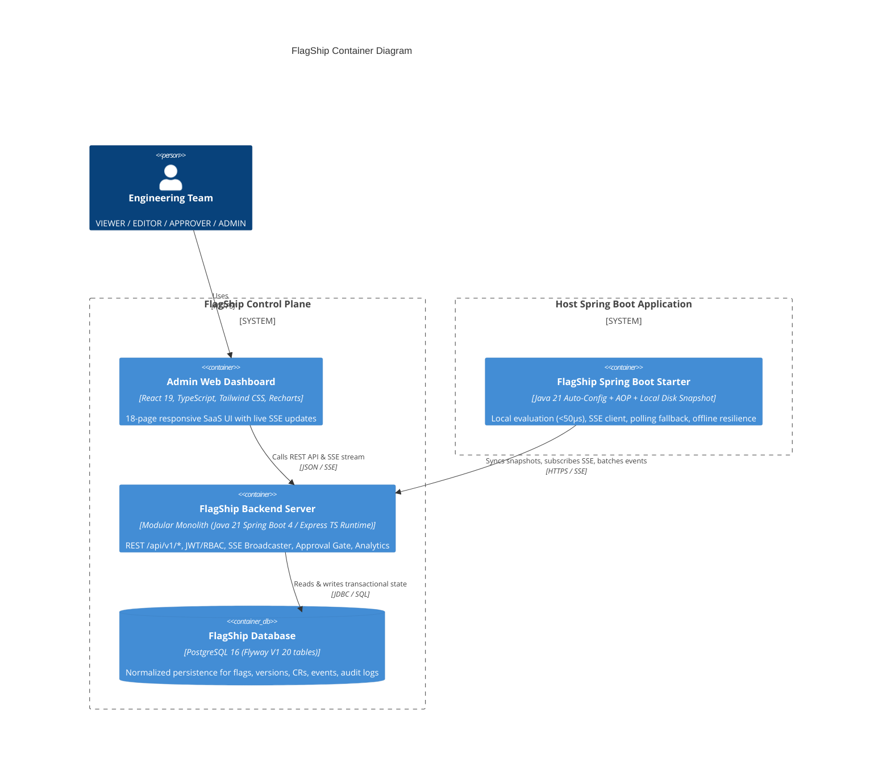
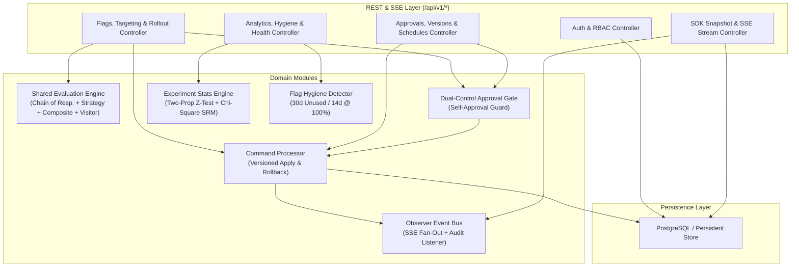

# FlagShip Software Architecture (C4 Model)

## 1. C4 Level 1 — System Context Diagram

## 2. C4 Level 2 — Container Diagram

## 3. C4 Level 3 — Backend Modular Monolith Component Diagram

## 4. Module Boundaries (Enforced via ArchUnit C6)
- Controllers strictly delegate to Domain Services/Commands and never access repositories directly.
- `flagship-shared` has zero dependency on Spring Web, JPA, or database drivers so both server preview and client SDK share identical evaluation semantics.
