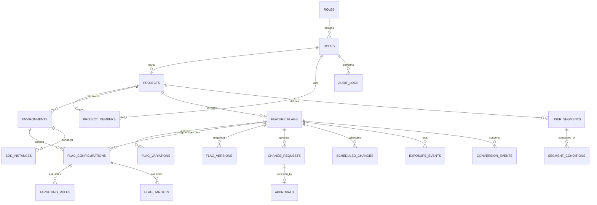

# FlagShip Database Design (PostgreSQL 16 + Flyway)

FlagShip uses a normalized 20-table PostgreSQL schema (`flagship-server/src/main/resources/db/migration/V1__initial_schema.sql`) enforcing referential integrity, unique keys, check constraints, indexes for hot paths, and optimistic locking (`optimistic_lock_version`).

## Entity-Relationship Diagram

## Key Design Decisions
- **Optimistic Locking**: `feature_flags.version` and `flag_configurations.optimistic_lock_version` prevent silent lost updates during concurrent admin edits.
- **Immutable Version Snapshots**: `flag_versions` stores both `before_snapshot` and `after_snapshot` JSONB documents enabling zero-loss side-by-side diffs and deterministic rollback.
- **Hygiene Indexes**: Composite index `idx_flag_cfg_hygiene (last_evaluated_at, full_rollout_since)` makes FR9 stale-flag queries O(log N).
- **Analytics Partition-Ready Tables**: `exposure_events` and `conversion_events` are append-only with `(experiment_id, variation_id)` composite indexes for fast aggregation.
