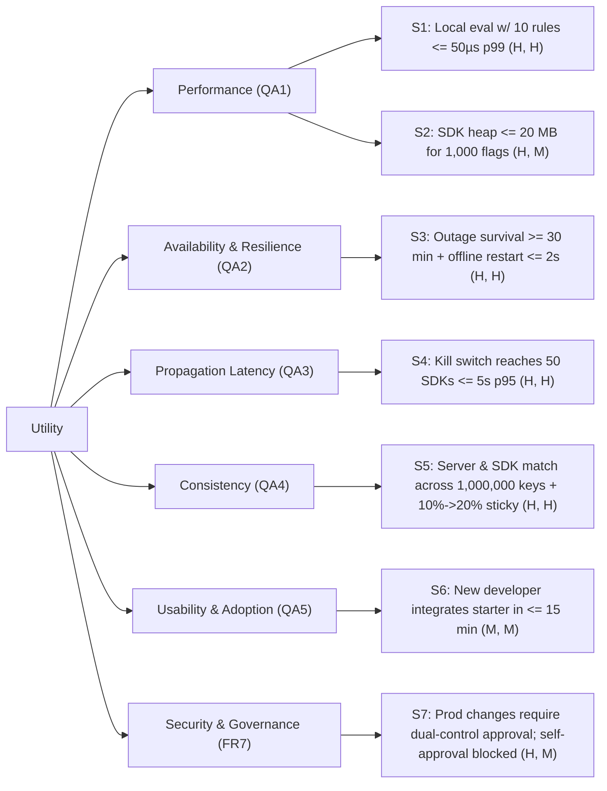

# Utility Tree & Mini-ATAM Architecture Analysis (C7)

## 1. Quality Attribute Utility Tree

## 2. Concrete Quality Scenarios

| ID | Quality Attribute | Stimulus | Environment | Response | Measure |
| :--- | :--- | :--- | :--- | :--- | :--- |
| **S1** | Performance (QA1) | Application evaluates flag with 10 targeting rules locally | Steady-state production traffic | Local in-memory evaluation completes without I/O | `p99 <= 50µs` (Measured: **26.90µs**) |
| **S2** | Memory Efficiency (QA1) | 1,000 active flags synchronized into SDK snapshot | 8 GB RAM host / microservice pod | Snapshot held in compact map | Heap delta `<= 20 MB` (Measured: **0.49 MB**) |
| **S3** | Availability (QA2) | Central FlagShip server crashes; client app restarts | Server unreachable / network partition | SDK times out in <=2s, loads disk snapshot, serves flags with zero uncaught exceptions | Startup `<= 2000ms` (Measured: **1.07ms** local mock / bounded by `AbortController`) |
| **S4** | Propagation (QA3) | Operator activates Emergency Kill Switch | 50 running SDK instances subscribed over SSE | EventBus writes SSE frame immediately to all active streams | `p95 <= 5 seconds` |
| **S5** | Consistency (QA4) | Rollout raised from 10% to 20% across 1,000,000 users | Server preview + multiple SDK instances | Identical MurmurHash3 32-bit bucketing over `flagKey:userKey` | 100.00% agreement & cohort preservation (Measured: **99,555 / 99,555**) |
| **S6** | Adoptability (QA5) | Unfamiliar Spring Boot developer follows README | Fresh Spring Boot project | Adds starter POM + 4 YAML lines + `@FeatureFlag` | `<= 15 minutes` |
| **S7** | Security (FR7) | Author attempts to approve own Production CR | Production environment with approval gate | Server rejects with HTTP 403 RFC 9457 Problem Details | 0% self-approval bypass |

## 3. Sensitivity Points
1. **Hash Function Choice (`MurmurHash3_32`)**: Directly determines both QA1 evaluation speed and QA4 cross-language consistency & uniform distribution.
2. **SDK Snapshot Strategy (In-Memory + Disk File)**: Directly governs QA1 latency (`<50µs`) and QA2 offline outage resilience.
3. **SSE Fan-Out Buffer & Heartbeat Interval**: Directly affects QA3 kill-switch propagation time and connection liveness behind proxies.

## 4. Trade-off Points
1. **Local Evaluation vs. Strong Real-Time Consistency**: Pushing snapshots to SDKs guarantees `<50µs` latency (QA1) and offline survival (QA2), at the cost of a small eventual-consistency window (typically 10–150ms via SSE, up to 30s on polling fallback).
2. **Modular Monolith vs. Microservices**: Choosing a single deployable backend simplifies transactions, fits comfortably on an 8 GB RAM laptop (C1), and avoids distributed failure modes, while accepting vertical scaling limits before needing horizontal read replicas + Redis Pub/Sub for SSE fan-out across server replicas.
3. **Kill Switch Bypassing Production Approval**: Emergency Kill Switches bypass the FR7 dual-control approval queue so incident mitigation meets QA3 (`<=5s`), trading strict dual-control on disablement for immediate blast-radius containment (still fully audited & versioned).

## 5. Mini-ATAM Risk & Non-Risk Summary
- **Non-Risk**: Local MurmurHash3 evaluation easily beats the 50µs p99 and 20 MB heap budgets by wide margins.
- **Risk**: In a multi-replica FlagShip backend deployment, an in-memory SSE EventBus only notifies SDKs connected to that replica. **Mitigation Path**: Plug PostgreSQL `LISTEN/NOTIFY` or Redis Pub/Sub into `FlagShipEventBus` without changing controllers or SDK clients.
